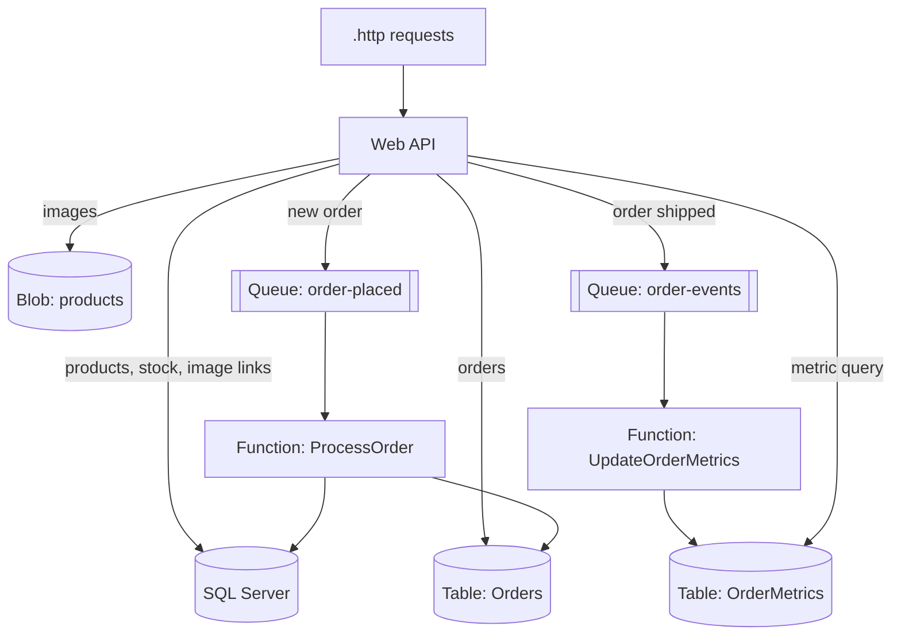

# WidgetStore

A proof of concept for the Cloud Databases course, Assignment 1: Online Store.

## The assignment

Widget and Co sells widgets online and wants to move their website from a small hosting company to Azure. The site has become popular, and at busy moments it gets slow. Most of the trouble comes from customers placing orders.

There are a few other things in the story too:

- The order date is saved, and later the shipping date. Together they give the "order processed" metric.
- Customer info is shared with another department of the parent company.
- Product details live in a traditional SQL database, and there are product images.
- Customers can post anonymous reviews, which marketing wants to use later.

The task was to build a proof of concept in C# (a Web API plus at least two Azure Functions), with the focus on how the data is stored in the cloud. No frontend was needed.

## What I used

- .NET 10 and an ASP.NET Core Web API
- Azure Functions (isolated worker)
- MediatR for commands and queries
- Entity Framework Core with SQL Server
- Azure Table Storage, Queue Storage and Blob Storage
- Docker to run SQL Server and Azurite (the Azure Storage emulator) on my laptop
- xUnit and Moq for the unit tests
- `.http` files in Rider to call the API, since there is no frontend

Everything runs locally against the emulators. The code uses the real Azure libraries, so moving it to Azure would mostly mean changing the connection strings.

## Why I built it this way

The main idea is that different kinds of data need different kinds of storage. I didn't want to put everything in one database just because that's easier.

**Products and stock in SQL.** The assignment already says products live in a SQL database, and it made sense to keep stock there too. Stock is the one number that really can't be wrong. If two people buy the last widget at the same moment, only one of them should get it. SQL handles that well with a single update that checks and subtracts in one go:

```sql
UPDATE Products SET Stock = Stock - @qty WHERE Id = @id AND Stock >= @qty
```

If no row changes, there wasn't enough stock. I also added a check constraint so the database itself refuses negative stock, and an index on `Category` because listing products per category is the most common query.

**Orders in Table Storage.** Orders are the thing that floods in at peak hours, so I wanted a store that is cheap to write to and spreads the load. In Table Storage every row has a partition key and a row key. I used:

- PartitionKey = `customerId`
- RowKey = `orderId`

My first thought was to partition by order date, but then every order placed today would land in the same partition. That one partition becomes the bottleneck, which is exactly the problem the assignment describes. Using the customer id spreads the orders over many partitions. It also means I can fetch one order with both keys, which is the fastest read Table Storage has. That's why the order URL contains both the customer id and the order id.

Table Storage can't store a list, so the order lines are saved as one JSON column inside the order row.

**Images in Blob Storage.** Images are files, not data, so they go in Blob Storage. SQL only keeps the link (`ImageUrl`). The browser loads the image straight from Blob, so image traffic never goes through the API or the database.

**A queue in front of the slow work.** Placing an order only saves the order as "Pending", puts a message on a queue and returns `202 Accepted`. The stock check happens afterwards in an Azure Function. When it gets busy, the queue just gets longer while the website stays fast.

**Metrics in their own table.** To get the average processing time, I didn't want to scan every order each time. Instead there is a small `OrderMetrics` table with one row per day (PartitionKey = month, RowKey = day). An Azure Function updates it every time an order ships. Asking for a month's metric is then one quick read. Several functions can update the same row at the same moment, so the update uses the row's ETag and retries if someone else changed it first.

I first planned to use Cosmos DB for the orders, but I switched to Table Storage so I could run everything locally on Azurite. The partition key idea stays the same either way.

## Following the lecturer's MediatR example

For the structure of the code I tried to follow my lecturer's example repo, [EDAMediatR](https://github.com/fdatInholland/EDAMediatR):

- Commands and queries are in separate folders, each with their own `Handlers` folder.
- Every command, query and handler has its own file.
- DTOs have their own folder.
- Orders have a separate read repository and write repository, so queries can only read and commands can write.

```
WidgetStore.Application
├── Commands
│   └── Handlers
├── Queries
│   └── Handlers
├── DTO
├── Messages
└── Interfaces
```

One thing I did differently is where the repository interfaces live. In the example they are in the data layer. I put them in the Application layer, so the business logic doesn't depend on the data layer at all. I explain why under "Loosely coupled".

## The Azure Functions

I built two functions. Both are started by a queue message:

- **ProcessOrder** listens to the `order-placed` queue. It reserves the stock for all lines of an order in one SQL transaction and marks the order Confirmed, or Rejected if there isn't enough stock. If the same message arrives twice, it sees the order is no longer Pending and does nothing, so stock is never taken twice.
- **UpdateOrderMetrics** listens to the `order-events` queue. When an order ships, it adds that order's processing time to the day's row in the `OrderMetrics` table.

I wasn't able to build the third function I had planned, **ExportReviewsForMarketing**, because I ran out of time. The idea was a timer function that runs every night and writes the day's reviews to Blob Storage as a JSON file for the marketing department. The anonymous reviews themselves aren't built either. On paper they would go in Table Storage with the product id as partition key and no customer id at all, so they stay anonymous.

The customer data that's shared with another department isn't built either. My plan for it is a separate SQL database with its own access rights, while the store only keeps the customer id on each order.

## How the design fits together



The solution has six projects:

| Project | What's in it |
| --- | --- |
| `WidgetStore.Api` | Controllers. They only turn a request into a command or query. |
| `WidgetStore.Functions` | The two Azure Functions. Just as thin as the controllers. |
| `WidgetStore.Application` | Commands, queries, handlers, DTOs and the interfaces |
| `WidgetStore.Domain` | `Order`, `OrderLine`, `Product` and their business rules |
| `WidgetStore.Infrastructure` | Code that talks to SQL Server, Table Storage, queues and Blob |
| `WidgetStore.Tests` | Unit tests |

The business rules live in the Domain. An order needs at least one line, the quantity per line is 1 to 10, and only a confirmed order can be shipped. If a rule is broken, the API returns `400 Bad Request` with the reason.

## How it works, step by step

1. A customer places an order (`POST /api/orders`). The API looks up the current prices in SQL, checks the rules, saves the order as **Pending** in Table Storage, puts a message on `order-placed` and answers `202 Accepted` right away.
2. **ProcessOrder** picks up the message and tries to reserve the stock in SQL. The order becomes **Confirmed**, or **Rejected** if there isn't enough stock.
3. The customer can check the order with `GET /api/customers/{customerId}/orders/{orderId}`.
4. The warehouse ships it (`PUT .../ship`). The shipping date is saved, the processing time is calculated, and a message goes on `order-events`.
5. **UpdateOrderMetrics** adds the processing time to that day's metrics.
6. `GET /api/metrics/order-processing?month=2026-11` returns the average for the month from the metrics table.

When I tested it, three orders were processed by the function at the same time and the stock still came out exactly right. An order for more Widget Minis than were in stock was rejected, and the stock stayed untouched.

## Loosely coupled

- **The layers depend on interfaces, not on each other's code.** The handlers only know contracts like `IOrderWriteRepository` and `IMessagePublisher`. The Infrastructure project provides the real versions. Because of that, the business logic doesn't know or care which database sits behind it. Swapping a storage type would only touch the Infrastructure project.
- **The API and the Functions don't call each other.** They only talk through the queues. Either one can be stopped, restarted or scaled on its own, and messages just wait in the queue until someone picks them up.
- **One place for wiring.** `AddInfrastructure()` registers all the real implementations, and both the API and the Functions use it.
- **It's testable.** Since the handlers only depend on interfaces, the tests can hand them fake versions instead of real databases.

## Unit tests

Run them with `dotnet test`. There are 12 tests, and none of them need Docker, a database or Azure. They use Moq to fake the repositories and the queue.

| Test file | What it checks |
| --- | --- |
| `OrderTests` | An order without lines is refused, a quantity of 0 or 11 is refused, a new order is Pending with the right total, a Pending order can't be shipped, and the processing time is the time between ordering and shipping |
| `PlaceOrderCommandHandlerTests` | A new order is saved as Pending and exactly one message goes on the queue. An unknown product is refused and nothing is saved or sent. |
| `ReserveStockCommandHandlerTests` | Not enough stock means the order is Rejected. The same message arriving twice doesn't reserve stock a second time. |
| `GetOrderMetricsQueryHandlerTests` | The average is total hours divided by orders shipped. A month with no shipped orders has no average. |

## Does this solve the peak-hour problem?

Mostly, yes. The assignment says placing orders is what made the site slow at busy times. In a typical setup, the customer waits while everything happens: checking stock, updating it and saving the order. At peak time those requests pile up and wait on each other.

In this design the customer doesn't wait for any of that:

- Placing an order only saves one row and puts one message on a queue, then returns `202 Accepted`. That takes milliseconds, no matter how busy it is.
- The slow part, reserving stock, happens afterwards in the ProcessOrder function. A rush of orders makes the queue longer instead of making the website slower.
- In Azure, the functions scale out when the queue grows. Locally I saw three orders being processed at the same time, and the stock still came out right.
- Orders are spread over many partitions because the partition key is the customer id, so there's no single hot partition taking all the writes.
- Images come straight from Blob Storage and the metric comes from a small read model, so neither adds load to the order flow.

There are some limits I'm aware of:

- **I didn't load-test it.** I tested that it works correctly, not how many orders per minute it can handle. That would need a proper load test on Azure.
- **The bottleneck moves to SQL.** Every order still updates stock in SQL. If thousands of people buy the same popular product, they all update the same row. To handle that I would limit how many functions run at once, or scale up the database.
- **Prices are still read from SQL when an order is placed.** That's a quick read, but at very high traffic a cache would take that load away.
- **The customer first sees "Pending".** The order is confirmed a moment later. 
- **The real scaling only happens in Azure.** Locally everything runs on one machine, so the automatic scale-out isn't something I could show here.

So the design fixes the cause the assignment points to: placing an order is now fast and the heavy work happens in the background. It's a proof of concept, though, so the numbers would still need to be proven in Azure.

## Running it

**You need:** the .NET 10 SDK, Docker Desktop, and Azure Functions Core Tools v4 (check with `func --version`).

1. Start SQL Server and Azurite in Docker. Pick any strong password and use the same one in steps 2 and 3.
   ```powershell
   docker run -d --name sqlserver -e "ACCEPT_EULA=Y" -e "MSSQL_SA_PASSWORD=<your password>" -p 1433:1433 mcr.microsoft.com/mssql/server:2022-latest
   docker run -d --name azurite -p 10000:10000 -p 10001:10001 -p 10002:10002 mcr.microsoft.com/azure-storage/azurite
   ```
2. Give the API its SQL connection string (run this in the solution folder):
   ```powershell
   dotnet user-secrets set "ConnectionStrings:Sql" "Server=localhost,1433;Database=WidgetStore;User Id=sa;Password=<your password>;TrustServerCertificate=True;" --project WidgetStore.Api
   ```
3. Copy `WidgetStore.Functions/local.settings.example.json` to `WidgetStore.Functions/local.settings.json` and put the same password in it.
4. Run the unit tests (no Docker needed): `dotnet test`
5. Start the API: `dotnet run --project WidgetStore.Api --launch-profile http`. It runs on http://localhost:5087, and creates the database and the four example products on the first start.
6. In a second terminal, start the Functions: `cd WidgetStore.Functions`, then `func start`.
7. Open `WidgetStore.Api/WidgetStore.Api.http` and run the requests from top to bottom. After placing an order, paste its `orderId` into the variable at the top of the file.
